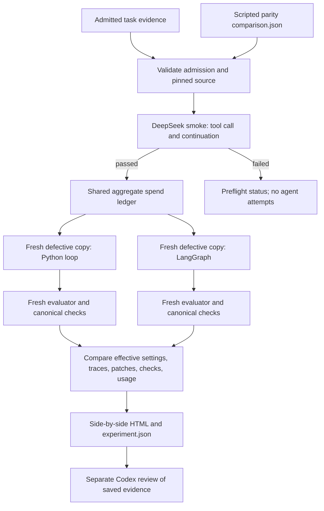

# First matched Python and LangGraph comparison

The coordinator for ticket #8 is `python -m agent_eval_harness.cli.run_matched_comparison`. It validates the admitted task and scripted parity evidence, runs a bounded DeepSeek tool-call smoke check, then starts one Python-loop attempt and one LangGraph attempt with the same task, provider settings, context policy, and per-attempt budgets. Each call to `attempt_and_evaluate` builds a fresh defective task copy and performs canonical evaluation in a separate fresh evaluator environment.

The first live HTTPS pair completed on 10 October 2026 at harness revision `5be6a3f7a5627ea3df9085e46a5d94e379df7ec2`, after fresh admission and all three scripted parity scenarios passed. Direct DeepSeek `deepseek-flash` smoke passed tool call and continuation. Both attempts and independent evaluations completed with matched effective settings, and root visually inspected the comparison and recorded reviews bound to the exact saved attempts.

| Implementation | Canonical checks | Calls | Stop | Estimated USD |
|---|---:|---:|---|---:|
| Python loop | 9/9 | 8 | provider_output_limit | 0.008226948 |
| LangGraph | 6/9 | 10 | model_call_budget | 0.004686546 |

The Python run saved a one-line title-tokenization repair. Its visible unit suite passed 28 tests, but a harder competing-body example remained unresolved before its last response exhausted the 2,048-token output limit. LangGraph explored scoring variants inside shell commands without saving a patch; title retrieval, title context and input-order independence failed. The entire measurement path worked, so the first milestone is achieved despite one failed repair. These outcomes do not establish reliable rankings or fully calibrated budgets.

The total usage-based estimate including smoke was USD 0.01306953. Provider-confirmed charges were unavailable. The sequential LangGraph run received a warm prefix cache on its first call; the cost difference is not a controlled orchestration effect. Original artifacts remain unchanged, including the coordinator-time `pending_human_review` flag in `experiment.json`; a separate `acceptance-review.json` records the subsequent Codex review. Human PR review is a separate step.

Local deliverables are kept next to the repository at `../evidence/live-first-2026-10-10/`: `report.html`, `review-summary.md`, `acceptance-review.json`, manifests, full traces/tool outputs, candidate patches, checks and exact-attempt review records. They remain outside Git because they include target-repository source excerpts. The original source checkout was not edited. Controlled provider-transport fixtures remain distinct from this live pair.

## Reproduce the comparison

Use the persistent Python environment that has the pinned LangGraph dependency set. Replace the `/path/to/...` placeholders with your own paths. Keep the API key file outside the harness and task repositories. Fresh prerequisites are generated for the current harness revision; prior admission/parity files remain evidence of their original revision.

```bash
cd /path/to/agent-eval-harness

PYTHON=/path/to/venv/bin/python
SOURCE=/path/to/prompt-engineering-group-project
RUN_TAG=$(date -u +%Y%m%dT%H%M%SZ)
EVIDENCE=/path/to/evidence/reproduction-$RUN_TAG
ADMISSION=$EVIDENCE/admission/admission.json
PARITY=$EVIDENCE/parity/comparison.json
OUTPUT=$EVIDENCE/matched

"$PYTHON" -m agent_eval_harness.cli.admit \
  --source-repository "$SOURCE" --output-dir "$EVIDENCE/admission"
"$PYTHON" -m agent_eval_harness.cli.run_langgraph_parity \
  --admission-evidence "$ADMISSION" --source-repository "$SOURCE" \
  --output-dir "$EVIDENCE/parity"

"$PYTHON" -m agent_eval_harness.cli.run_matched_comparison \
  --credential-file /path/to/deepseek-api-key.txt \
  --admission-evidence "$ADMISSION" \
  --parity-evidence "$PARITY" \
  --source-repository "$SOURCE" \
  --artifact-dir "$OUTPUT"
```

The output directory must not already exist. The command checks that the admission result is `admitted`, that all three scripted parity scenarios passed for the same task and source revision, and that the credential and artifacts sit outside the harness and source repositories. It writes the run plan before the first provider request.

To regenerate the scripted prerequisite, select a new output directory because parity runs preserve their artifacts and refuse to overwrite an existing run:

```bash
"$PYTHON" -m agent_eval_harness.cli.run_langgraph_parity \
  --admission-evidence "$ADMISSION" \
  --source-repository "$SOURCE" \
  --output-dir /path/to/evidence/issue-6/reproduction
```

Then set `PARITY` to that directory's `comparison.json` and run the matched command. Both deterministic prerequisites use Docker but make no hosted-model request. The matched command requires the live provider smoke to pass before it starts either coding-agent attempt.

## What the coordinator records

The starting calibration proposal is USD 1.00 for the aggregate ledger, with up to USD 0.10 for smoke and USD 0.30 for each repair attempt. Both attempts also receive the same limits: 10 model calls, 128 KiB of serialized context, a 10-minute attempt deadline, 60-second shell commands, 16 KiB model-visible tool output, 2,048 output tokens, one provider retry, five seconds for cleanup, and 90 seconds for canonical evaluation. These ceilings are experimental settings for this first run; they are not accepted benchmark defaults or evidence of calibration across repeated runs.

One parent `SpendBudget` accounts for smoke and both attempts. Each stage has its own child ceiling, and every request reserves the peak uncached-input plus maximum-output estimate before the HTTPS transport runs. Failed requests and requests without usage keep their reservation. Provider-reported charges, usage-based estimates, and unavailable amounts remain separate in the attempt artifacts.

The output directory contains `run-plan.json`, `smoke/smoke.json`, `experiment.json`, and `report.html`. Each records whether execution used the normal `live_https` transport or a test-only `controlled_transport`. Successful smoke is followed by these attempt directories:

```text
python-loop/
  metadata.json  trace.jsonl  candidate.patch  checks.json  report.html
langgraph/
  metadata.json  trace.jsonl  candidate.patch  checks.json  report.html
```

Each attempt also retains complete tool output files and its collected candidate files. The comparison report links to the attempt traces, tool results, patches, and canonical checks. The initial effective context is fingerprinted and checked for equality. The report shows configuration differences and marks qualitative reviews as pending until a reviewer records findings against these exact saved attempts.

If the credential file cannot be read or the smoke fails, the coordinator records `preflight_failed`, emits a status report, and starts no agent attempt. If a provider or task environment fails during an attempt, it records an invalid measurement, preserves available attempt artifacts, and skips the other run if the failure occurs first. Neither case is counted as an agent repair failure. A valid measurement can still have `functional_verdict: failure`; that verdict comes only from the independent canonical checks.

## Task-to-report path



Admission establishes the task before any attempt. Scripted parity checks exercise shared model/tool/evaluation behavior without relying on live generation. Smoke checks account access and a provider tool-call continuation before either attempt. The attempt boundary builds the defective baseline from the pinned source revision, prepares the task container, constructs the same initial context, runs the selected orchestrator, collects the complete patch, and evaluates it in a separate fresh environment. The final renderer reads saved attempt artifacts only; it does not rerun a model or change a verdict.

The two live conversations may produce different investigations, tool sequences, patches, token counts, and termination reasons. Inspect those differences in the traces instead of expecting patch identity. One task and one attempt per orchestrator do not support reliable rankings.

## Learning checkpoint and next experiment

After a valid pair exists, read `experiment.json` first. Then compare each `metadata.json` for task revision, shared context fingerprint, model settings, dependency versions, budgets, and task image recipe; follow the model/tool events in `trace.jsonl`; inspect the full tool outputs, candidate patches, and independent check messages; finally review the paired HTML. Note where the model first makes a different choice and whether that choice changes the patch or only the path to it. Keep a repair failure separate from a provider, task-container, evaluator, or report failure.

Complete the qualitative review only from these actual artifacts. Until then, leave both reports in the pending state. If review records are later prepared for these attempts, regenerate the report with `agent_eval_harness.reports.compare_report --python-review ... --langgraph-review ...`; review records must identify the exact attempt and source revision.

No additional paid run was performed after this first pair. The next agreed one-variable harness experiment should change only `max_context_bytes` from 128 KiB to 64 KiB while keeping the task, model, prompts, tools, other budgets, orchestrators, and evaluator fixed. It should reuse `attempt_and_evaluate`, its existing attempt artifacts, and the same independent evaluation boundary. Run enough paired repetitions to distinguish a context-limit effect from one stochastic response; do not treat a single follow-up pair as a ranking.

The output-limit stop also suggests a separate experiment varying only the output-token ceiling. Keep it separate from the context-ceiling experiment so the effect remains interpretable.
